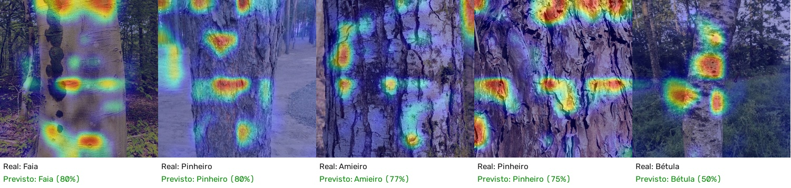
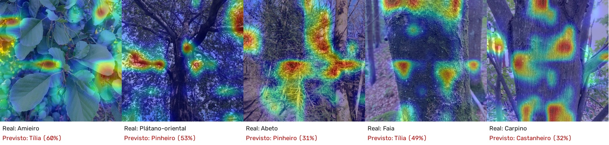
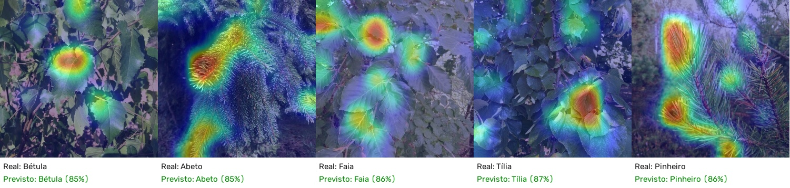
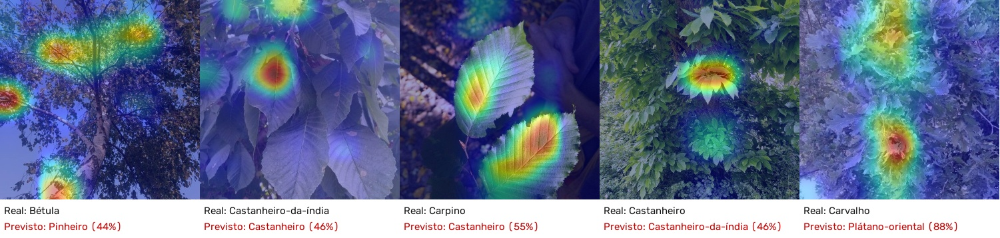

# Galeria de acertos e erros

Cada cartão mostra a foto com o mapa de calor Grad-CAM da espécie prevista. Verde: acerto; vermelho: erro.

## Casca (convnext_tiny, fotos de campo do GBIF)

| Foto | Real | Previsto |
|---|---|---|
| `casca_campo/alder/2e61d000176fb777319cbc77cd7a51883c277a5e.jpg` | Amieiro | Tília |
| `casca_campo/oriental plane/cc5ca65b6f78b8891182bff20fa373b89188144c.jpg` | Plátano-oriental | Pinheiro |
| `casca_campo/spruce/f0174345560f4e015ab092a43f880e97fd0d9f3e.jpg` | Abeto-da-noruega | Pinheiro |
| `casca_campo/beech/53580f4a99f16fa5277a80078e9aeaed026dd88c.jpg` | Faia | Tília |
| `casca_campo/hornbeam/0a3c05d1743d483ae2070d0bf19ba73495fe484e.jpg` | Carpino | Castanheiro |

Comentário dos erros: (1) a foto do amieiro, embora marcada como *bark* no GBIF, mostra só folhas: ruído de rótulo da base de campo, que também pesa na acurácia de campo; (2) plátano e abeto aparecem como árvores inteiras contra o céu, longe do tronco: o mapa de calor se espalha pelos galhos e o modelo, treinado com casca de perto, confunde com pinheiro; (3) faia e carpino têm casca lisa e acinzentada, parecida com tília e castanheiro jovem. Quatro dos cinco erros ficaram abaixo do limiar de 60% e seriam marcados como inconclusivos. Lição para o usuário: recortar o tronco de perto (ROI) melhora a resposta.

## Folha (convnext_tiny, teste das folhas do GBIF)

| Foto | Real | Previsto |
|---|---|---|
| `folhas/test/birch/96f3d30a7c7b30c175dbcf555a5b44ddbe1e6a8e.jpg` | Bétula | Pinheiro |
| `folhas/test/horse chestnut/6c929d2177a96d380bae2e179455269cf286895d.jpg` | Castanheiro-da-índia | Castanheiro |
| `folhas/test/hornbeam/6704f27a07d9e8d358ae308716aefc8206da5554.jpg` | Carpino | Castanheiro |
| `folhas/test/chestnut/0c8ae00bfda3a3263d9474eacb05d4a78d188b57.jpg` | Castanheiro | Castanheiro-da-índia |
| `folhas/test/oak/b8057bb371f6987eef73986ac000339bbe9d23b3.jpg` | Carvalho | Plátano-oriental |

Comentário dos erros: (1) bétula fotografada como copa inteira, sem folha em destaque; (2) castanheiro e castanheiro-da-índia trocados entre si: apesar do nome popular, são gêneros diferentes, mas ambos têm folhas grandes, alongadas e serrilhadas, e a foto mostra um folíolo isolado; (3) carpino confundido com castanheiro pela borda serrilhada e nervuras paralelas; (4) carvalho previsto como plátano-oriental com 88%: os dois têm folhas lobadas, e é o único erro confiante — o limiar não o pegaria. Os outros quatro ficaram abaixo de 60%.
