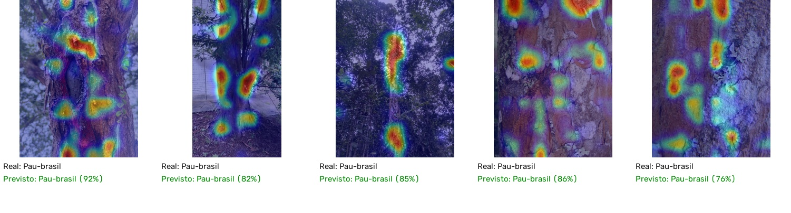
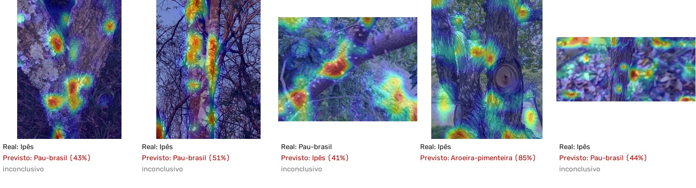
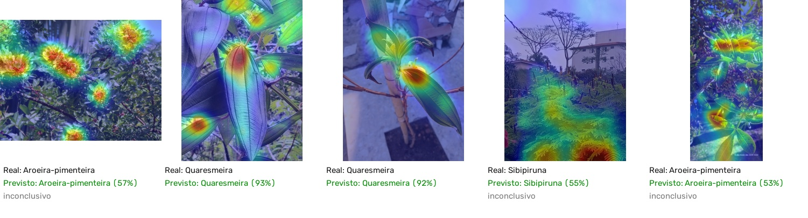
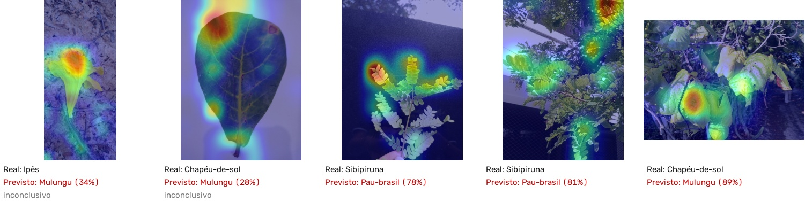
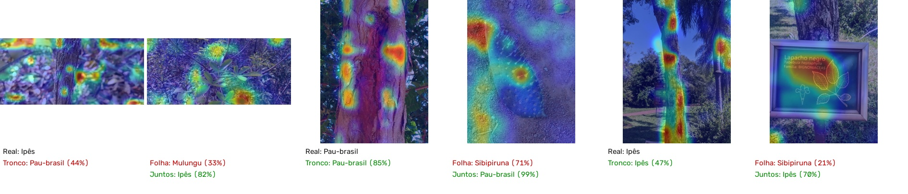
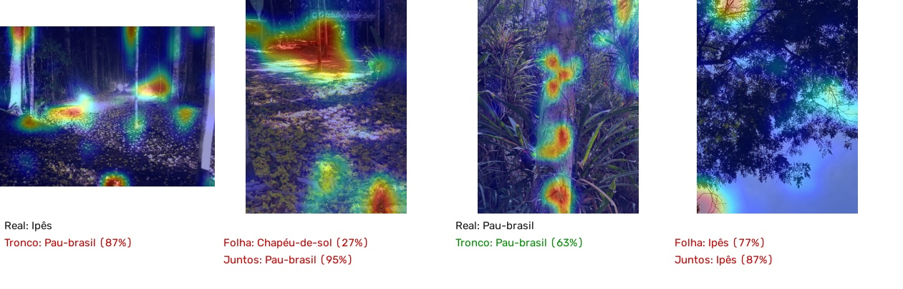

# Galeria de acertos e erros: árvores brasileiras

ConvNeXt-Tiny, conjunto de teste da base do iNaturalist (nunca usado no treino). Cada foto mostra o mapa de calor Grad-CAM da espécie prevista. Verde: acerto; vermelho: erro; "inconclusivo" quando a confiança fica abaixo do limiar de 60%. Gerada por `scripts/galeria_br.py`; a lista dos casos está em `docs/galeria_br.json`.

## Tronco (3 espécies)

**Comentário.** Nos acertos, o mapa de calor cai sobre a casca, em várias placas do tronco. Nos erros, ipê e pau-brasil se confundem entre si: os dois têm casca acinzentada com placas, e as fotos mostram o tronco de longe, no meio de galhos e folhagem (2ª e 5ª foto) ou um galho em vez do tronco (3ª). Quatro dos cinco erros ficaram abaixo do limiar e seriam marcados como **inconclusivos**. O único erro confiante (ipê previsto como aroeira, 85%) é um tronco com nó e casca rugosa, parecido com o da aroeira.

## Folha (10 espécies)

**Comentário.** Dois erros vêm de fotos que nem são de folha, separadas por engano pelo PaliGemma: a 1ª é uma **flor** de ipê caída no chão. Sibipiruna e pau-brasil se confundem porque as duas têm folhas compostas com folíolos pequenos, da mesma família (Fabaceae). Chapéu-de-sol foi confundido com mulungu em fotos de uma folha isolada ou de folhagem de perto. Dois dos cinco erros ficaram abaixo do limiar.

## Tronco + folha da mesma árvore (3 espécies)

Pares em que **a fusão corrigiu** um dos modelos:

Pares em que **a fusão errou**:

**Comentário.** Quando um dos modelos erra com pouca confiança, o outro puxa o resultado para a espécie certa (1º par: tronco 44% errado e folha 33% errada, juntos 82% certo). A fusão erra quando um modelo erra com muita confiança: no 2º par de erros, o tronco acerta pau-brasil com 63%, mas a folha diz ipê com 77%, e a fusão segue a folha. As fotos do iNaturalist também trazem ruído: no 3º par corrigido, a "folha" é uma placa de identificação da árvore.
